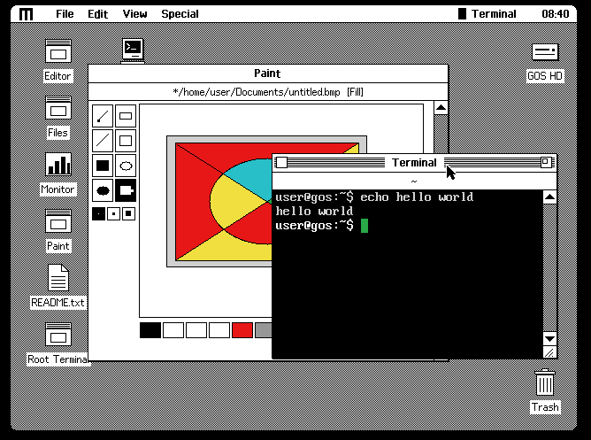

# GOS

GOS (Green Operating System) is a small hobby operating system written from scratch in C and assembly. It runs on 32-bit x86 PCs and on ARM (ARM926EJ-S), boots straight into a graphical desktop, and has a Unix-style shell, a simple filesystem and a handful of desktop applications.

The interface is modeled after classic Mac OS System 6. GOS is not affiliated with Apple.



Current version: 0.6

## What it has

Kernel

- Ring 0 kernel with paging, ring 3 user programs and a syscall interface
- Preemptive multitasking, 100 Hz timer, up to 32 tasks
- ELF32 loader for static user programs, which are embedded in the kernel image as an initrd
- Physical memory manager and a kernel heap
- Memory map from E820 or E801 on x86, from ATAGs on ARM (32 MB default if there are none)
- Drivers: PS/2 keyboard and mouse, VBE framebuffer (640x480), ATA disk, RTC, serial, PC speaker
- ARM port: ARM926EJ-S on the QEMU `versatilepb` board with CLCD video, KMI input and an SD card

Filesystem

- In-memory VFS with users (`root`, `user`) and rwx permissions
- Virtual `/dev`, `/proc` and `/bin`, plus pipes
- The filesystem is saved to disk as snapshots, alternating between two slots (A/B), so a write that gets interrupted does not destroy the last good copy

Desktop

- Window manager with drag, resize and zoom, a menu bar, Alt+Tab and MultiFinder-style Hide / Show All
- Desktop icons, a Trash, drag and drop between windows and the desktop
- Dialogs, a shared clipboard, and the control panel for mouse, keyboard, sound, date and desktop colors
- Two bitmap fonts, GOS Chicago and GOS Geneva, generated from ASCII-art sources in `tools/fonts`

Applications

- Terminal, with history, tab completion, pipes, redirects, `$VAR`, `;` and `&`
- Files (a Finder-style file manager), Editor, System Monitor
- Paint (reads and writes uncompressed 8-bit and 24-bit BMP)
- Calculator, Puzzle, Key Caps, Clipboard viewer, Note Pad, Scrapbook, Alarm Clock, Get Info, Control Panel
- Small background programs for testing: `ticker`, `counter`, `burn`, `upper`

Shell commands

```
help ls cd pwd cat echo mkdir rmdir rm touch cp mv chmod chown stat tree
head tail wc grep sort seq tee xxd date uptime uname whoami id hostname
ps kill spawn free df dmesg env export sync mount which sh true false
clear exit reboot poweroff shutdown edit files top term
```

## Requirements

You need a Linux (or similar) host. The build uses the GNU toolchain and nothing else is downloaded.

x86 build

- GNU make
- gcc that can target 32-bit x86 (`-m32`). On Debian and Ubuntu that is `gcc-multilib`
- binutils: `as`, `ld`, `ar`, `objcopy`, `strip`, `nm`
- coreutils and a POSIX `sh`
- `qemu-system-i386` to run it

ARM build

- Either `arm-none-eabi-gcc` with its binutils, or `clang` with `ld.lld` and the LLVM tools (`llvm-ar`, `llvm-objcopy`, `llvm-strip`, `llvm-nm`). The Makefile picks the GNU toolchain if it finds it and falls back to LLVM otherwise. Force one with `TOOLCHAIN=gnu` or `TOOLCHAIN=llvm`
- `qemu-system-arm` to run it

Optional

- Python 3 to regenerate the fonts (`make fonts`) and to run the test scripts in `tools/`
- Pillow, only for the font preview
- A host C compiler (`cc`) for the ARM emulator in `tools/armemu`

Example setup on Debian or Ubuntu:

```
sudo apt install build-essential gcc-multilib binutils qemu-system-x86 python3
sudo apt install gcc-arm-none-eabi qemu-system-arm     # only for ARM
```

The code is compiled with `-Wall -Werror`, so a compiler much newer than the one it was written with may stop on a new warning.

## Building and running

x86:

```
make            # builds os.img
make run        # boots it in QEMU, serial output goes to your terminal
```

ARM:

```
make ARCH=arm
make ARCH=arm run
```

Other targets:

```
make size       # kernel + BSS size against the 512 KB limit
make debug      # QEMU paused, GDB server on port 1234
make fonts      # regenerate kernel/gfx/fontdata.c
make membench   # boot at several RAM sizes and report which ones work
make clean
```

Useful variables: `QEMU` (emulator binary), `IMG` (disk image path), `QMEM` (RAM for the ARM machine in MB, default 128), `NO_E820=1` (x86, skip the E820 memory map).

The disk image is an empty 8 MB file. On first boot GOS creates its filesystem tree and writes it to the disk when you use Special > Save to Disk, the `sync` command, or after the automatic sync.

The kernel, initrd and BSS together must fit in 512 KB (0x10000 to 0x90000). The linker stops with an error if they do not, and `make size` shows how much is left.

## Using it

Keyboard shortcuts

- Alt+T terminal
- Alt+F file manager
- Alt+E editor
- Alt+M system monitor
- Alt+Tab switch windows

Things to try in the terminal:

```
cat /proc/meminfo
spawn ticker
cat /tmp/ticker.txt
ps | grep ticker
echo hello | upper
```

Icons on the desktop come from `/home/user/Desktop`. A file ending in `.app` that contains `app:terminal`, `app:files /tmp`, `app:edit /etc/motd` or `app:sysmon` becomes a launcher. Programs listed in `/etc/autostart` start at every boot. The `Root Terminal` icon opens a shell as root, so be careful with it.

## Project layout

```
abi/          structures and constants shared by kernel and user programs
boot/         x86 boot sector and entry code, ARM entry code, linker scripts
kernel/
  arch/       x86 and ARM specific code (paging, interrupts, context switch)
  drivers/    keyboard, mouse, video, ATA, SD, RTC, serial, speaker
  fs/         VFS, procfs, devfs, pipes, initrd, disk persistence
  gfx/        drawing, fonts, icons, cursor
  gui/        windows, widgets, menus, dialogs, desktop, events
  lib/        string, printf, buffers, time conversion
  mem/        physical memory manager, heap, user memory access
  proc/       tasks, scheduler, ELF loader, program launching
  sys/        syscalls, clipboard, settings
user/
  apps/       the applications and the shell
  lib/        small C library and GUI client library
  include/    headers for user programs
tools/        font generators, test harness, ARM emulator, build checks
```

## Testing

- `tools/check_build.sh` compiles and links the whole x86 tree without QEMU and checks the size limit
- `tools/gosvm.py` boots the image under QEMU through its monitor, sends keys and mouse input, takes screenshots and reads the saved filesystem back from the disk image
- `tools/mem_gui.py` boots at different RAM sizes and opens every application
- `make emutest` runs the ARM kernel on the small emulator in `tools/armemu`, for hosts without `qemu-system-arm`

## License

GOS is released under the Apache License, Version 2.0. See the `LICENSE` file for the full text.

One exception to note: `kernel/drivers/arm/font8x16.c` is generated from GNU Unifont by `tools/mkfont8x16.py`. Unifont is licensed under GPLv2 or later with a font exception, and the generated file stays under those terms.
